Automatic Mode sample
=====================

This is a sample project to be used with coreDS Unreal and Unreal Engine 5.2 or later. You can request a free trial at https://www.ds.tools/contact-us/trial-request/

coreDS Unreal must already be installed and activated to use this project. coreDS Unreal is not enabled by default: the sample's ``coreUnrealAutoMode.uproject`` already enables it (``coreDSModule``). If you copy this setup to your own project, enable coreDS Unreal in Edit > Plugins, or list ``coreDSModule`` in your ``.uproject``.

This sample showcases the Automatic Object Management mode. The Automatic Mode manages the complete life cycle of discovered objects, which makes it easy to receive information from DIS or HLA. You can receive and send DIS/HLA objects within a few minutes.

The sample project uses the following coreDS concepts:

- Connect
- Disconnect
- Send Update Object (send EntityStatePDU, or RegisterObjectInstance and UpdateAttributeValues)
- Receive Update Object (receive EntityStatePDU, or DiscoverObjectInstance and ReflectAttributeValues)
- Delete Objects (EntityStatePDU timeout or RemoveObjectInstance)

Runtime commands:

- Pressing K stops the connection and opens the configuration selection window. This lets you switch from one distributed simulation protocol to the other without closing the application.

Getting started
---------------

The first step is to configure coreDS Unreal to enable the Automatic Mode.

This configuration is in Edit > Project Settings > Plugins > coreDS, in the Automatic Mode category.

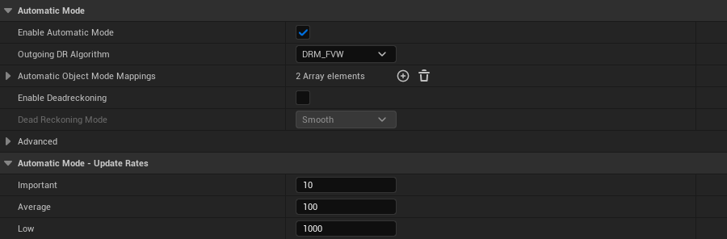

Each entry of "Automatic Object Mode Mappings" has an "Object Class Selector": a list of regular expressions. When a received object's ObjectClassSelector value matches one of them, the entry's "Actor to Spawn" is spawned. The entries are checked in order and the first match is used, so place your higher priority entries first and a wildcard last.

For each entry, you can enable or disable collisions and physics. We recommend leaving the collision and physics disabled at first, and enabling them once you have confirmed that the objects are spawned correctly.

In this sample, every EntityType matching 3.x.x.x.x.x.x (life forms) spawns a ``FirstPersonCharacter`` and every EntityType matching 2.x.x.x.x.x.x (munitions) spawns a ``FirstPersonProjectile1``.

The two local actors are also configured to send their position via DIS/HLA when spawned (the configuration is shown below).

coreDS Unreal manages the complete object life cycle, including the DIS keep-alive updates. Connect and disconnect are also taken care of automatically.

coreDS Unreal supports dead reckoning. It is disabled in this sample: enable it by checking "Enable Deadreckoning" in the Automatic Mode category of the coreDS settings. For dead reckoning to work, the DR properties must also be mapped correctly (see below).

The next step is to configure an actual connection with a distributed simulation protocol. coreDS supports HLA (High-Level Architecture) and DIS (Distributed Interactive Simulation).

Special note to HLA users
~~~~~~~~~~~~~~~~~~~~~~~~~

HLA can directly subscribe to very specific object classes without using a separate object type identification mechanism. coreDS Unreal provides two additional mechanisms to HLA users: you can also use the object class name (the complete FOM name, for example HLAobjectRoot.BaseEntity…) or the object instance name as the Object Class Selector. This lets you spawn actors based on the HLA object class, or spawn a particular object based on its unique name. The two mechanisms can't be used at the same time; if you need to distinguish a particular object out of a group, use the Blueprint interface.

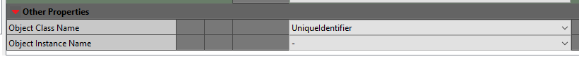

When configuring an HLA connection, you can link the ObjectClassSelector property to the "Object Class Name" or the "Object Instance Name".

The "Object Class Name" contains the value of the GetObjectClassName() function.

The "Object Instance Name" contains the instance name, as received in the DiscoverObjectInstance callback.

You can open the configuration window either by running the game or from Tools > Distributed Simulation > coreDS Unreal > Show coreDS UI.

This sample comes with 3 preconfigured configurations, in ``Content/coreDS``:

- ``DIS.coreDS``: DIS v5
- ``HLA_Player1.coreDS``: HLA 1516e with the RPR FOM 2.0
- ``HLA_Player2.coreDS``: HLA 1516e with the RPR FOM 2.0

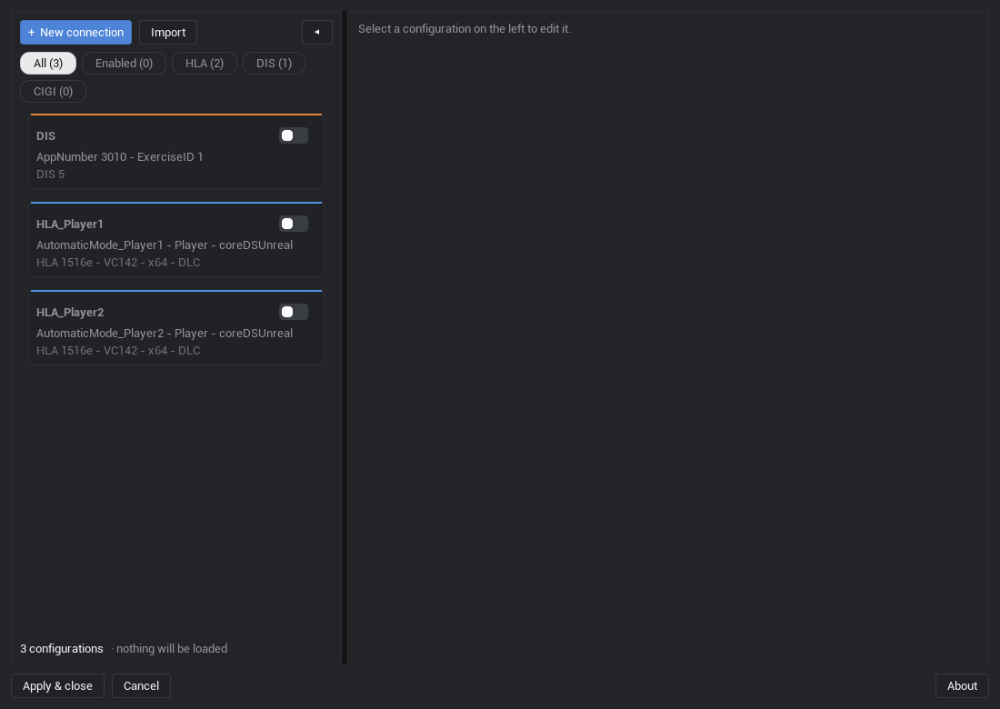

The FOM files are given by name only: the HLA configurations use the RPR FOM shipped with the sample, ``Content/coreDS/RPR_FOM_v2.0_1516-2010.xml``, next to the configurations, and the DIS configuration uses ``DIS_V5_IEEE_1278.1-1995_expert.xml``, shipped with coreDS Unreal in the plugin's ``ThirdParty/coreDS/bin`` folder (``coreDSModule/ThirdParty/coreDS/bin/VC143/x64/Release`` on Windows).

Let's take a look at each configuration.

(Directly jump to the `High-Level Architecture (HLA)`_ configuration.)

Distributed Interactive Simulation (DIS)
----------------------------------------

Configure the network adapter: click the "Network Interface Address" drop-down list and select your active network adapter. Set the destination address for your network too.

All the coreDS Unreal samples can run at the same time and see each other's entities. Their DIS configurations are DIS 5 on port 3000, exercise 1, listen on every network adapter (``0.0.0.0``) and broadcast to ``255.255.255.255``; each sample has its own Application Number (Automatic Mode 3010, Model Integration 3020 and 3021, First Person Shooter 3030, C++ 3040, Cesium 3050), since two simulators with the same Site and Application Numbers get their entities mixed up. Their HLA configurations join the ``coreDSUnreal`` federation with the RPR FOM 2.0 through the DLC (Dynamic Link Compatible) 1516e plugin, each with its own federate name. Give each running copy of this sample its own Application Number.

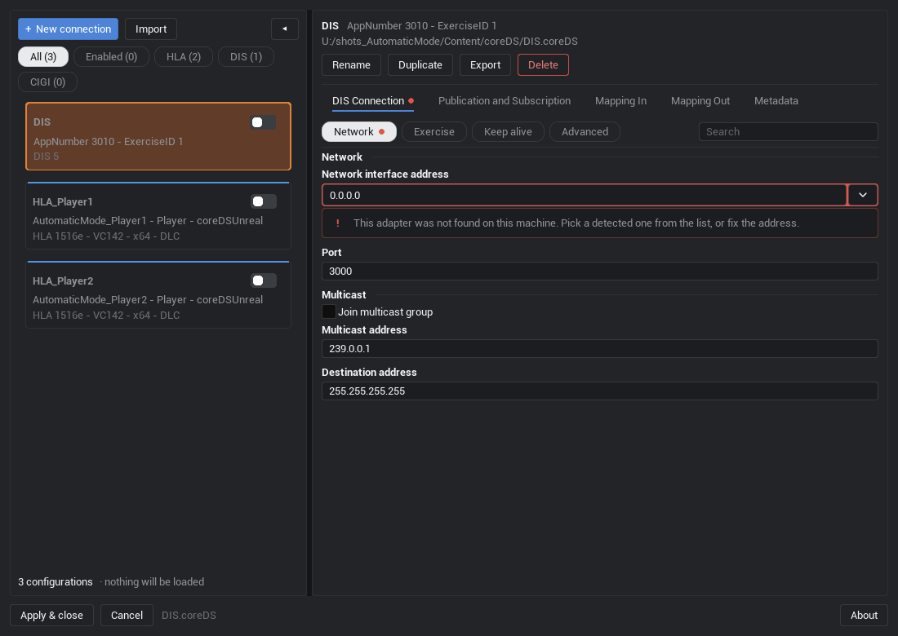

Even if DIS does not explicitly support subscriptions, coreDS supports incoming filtering. First, we must let coreDS know that we want to receive the EntityStatePDU. Publish the PDUs you want to send and subscribe to those you want to receive.

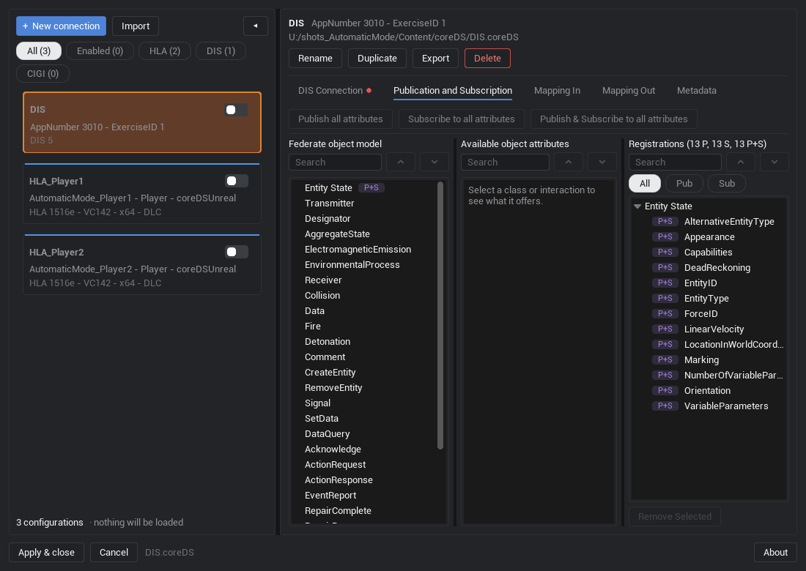

Receiving
~~~~~~~~~

Then comes the mapping configuration. To receive, we care about the "Mapping In".

The first step is to map a local object to a protocol object. "AutomaticMode" is listed in the "+" list. Link "Entity State" to "AutomaticMode".

Then you must map the local properties to the protocol properties. When receiving, we only map the values we are interested in: here, the location and the orientation. When using the Automatic Mode, the ObjectClassSelector must be set: it selects the actor to spawn. It can be anything; for example, you could assign it the Marking to select the actor based on the object name. In most cases, we use the EntityType. To do so, set the "On Data Received" script of the EntityType group to ``UseEntityTypeAsUniqueIdentifier.lua``.

Dead Reckoning
~~~~~~~~~~~~~~

If dead reckoning is enabled, you must map the DR properties like this:

Coordinates
~~~~~~~~~~~

Finally, we receive coordinates in geocentric format, which Unreal doesn't use. We could convert the coordinates within Unreal, but that would make it harder to switch to a different distributed simulation protocol. To keep everything configurable at runtime, we use the embedded Lua scripting engine to convert from geocentric coordinates to flat coordinates centred on a given latitude and longitude (the "Reference Latitude", "Reference Longitude" and "Reference Altitude" of the Scene settings).

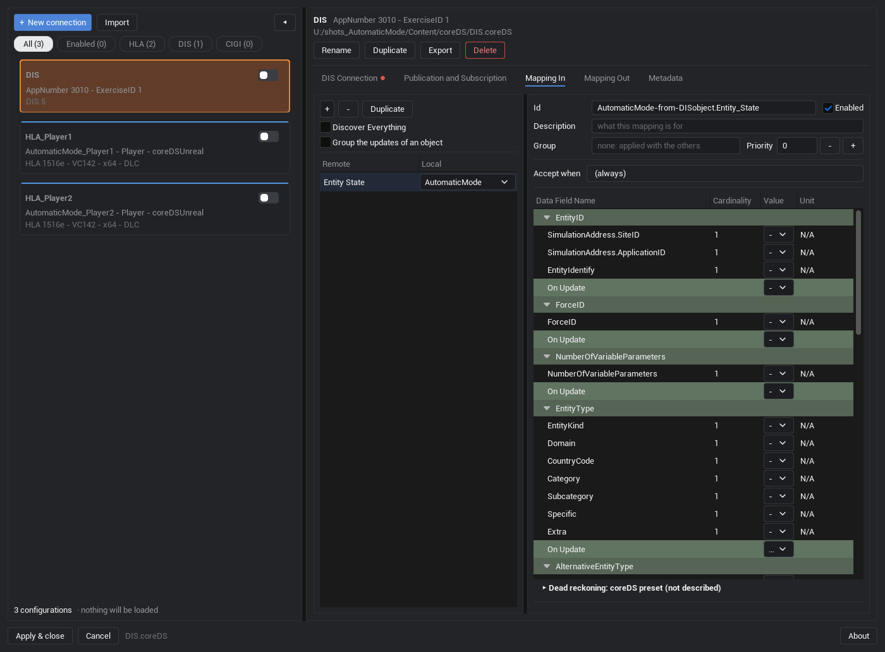

Below is ``convertPositionFromDISToUnreal.lua``, the "On Data Received" script of the Location group. It converts the location and the orientation. Unreal X is north and Y is east, and Unreal units are centimetres. Scripts are located in ``Content/coreDS/Script``.

.. code-block:: lua

   require("ReferenceLatLongAlt")
   angleConversions = require("angleConversions")
   require("ecef2lla")

   function convertPositionFromDISToUnreal(value)

      -- Since we are working over a fairly small part of the planet, we can assume a flat surface
      a, b, c = EcefToEnu(value['LocationInWorldCoordinates.X']:toDouble(), value['LocationInWorldCoordinates.Y']:toDouble(), value['LocationInWorldCoordinates.Z']:toDouble(), referenceOffset_Lat , referenceOffset_Long , referenceOffset_Alt )

      --convert geocentric to lat/long
      lat, long, alt = ecef2lla(value['LocationInWorldCoordinates.X']:toDouble(), value['LocationInWorldCoordinates.Y']:toDouble(), value['LocationInWorldCoordinates.Z']:toDouble())

      lat = 0.0174532925 * lat  -- convert to radian
      long = 0.0174532925 * long  -- convert to radian

      yaw = angleConversions.getOrientationFromEuler(lat, long, value['Orientation.Psi']:toDouble(), value['Orientation.Theta']:toDouble())
      pitch = angleConversions.getPitchFromEuler(lat, long, value['Orientation.Psi']:toDouble(), value['Orientation.Theta']:toDouble())
      roll = angleConversions.getRollFromEuler(lat, long, value['Orientation.Psi']:toDouble(), value['Orientation.Theta']:toDouble(), value['Orientation.Phi']:toDouble())

      value['Orientation.Psi']:set(roll)
      value['Orientation.Theta']:set(pitch)
      value['Orientation.Phi']:set(yaw)

      --scale back from meter to cm
      value['LocationInWorldCoordinates.X']:set(b*100)
      value['LocationInWorldCoordinates.Y']:set(a*100)
      value['LocationInWorldCoordinates.Z']:set(c*100)

   end

At this point, you are done. Depending on your Automatic Mode settings, each time an EntityStatePDU of a new entity is received, a new actor is spawned and coreDS Unreal handles its complete life cycle.

.. _automatic-mode-sample-dis-sending:

Sending
~~~~~~~

To publish an actor to the network, add the "coreDS sender component" to that actor or Blueprint.

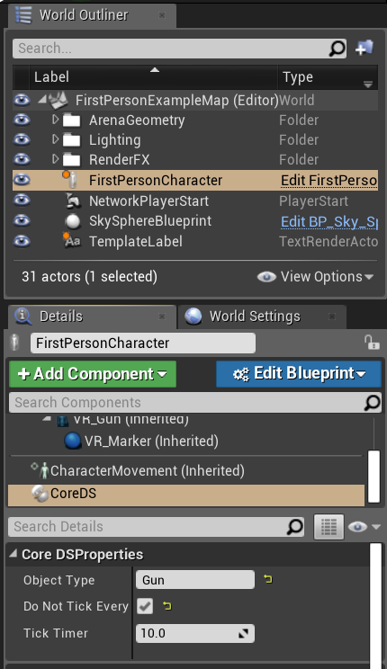

Once the component is added, set its "Object Type": all objects with the same object type use the same mapping. An object type is a string of your choice, unrelated to the naming convention of the distributed simulation protocol, that identifies a type of object in your simulator. In this sample, the ``FirstPersonCharacter`` Blueprint uses the object type "Gun" and the projectile uses "Munition".

Then comes the mapping configuration. To send, we care about the "Mapping Out".

The first step is to map a local object to a protocol object. The object types defined in the components are listed in the "+" list. Link each local object to a protocol object with the drop-down list next to the object name.

Then you must map the local properties to the protocol properties. When sending, you must fill the complete structure. Static values can be set at this point. Map Location and Orientation to the local properties.

Finally, we send coordinates in local format, which DIS doesn't use. To keep everything configurable at runtime, we use the embedded Lua scripting engine to convert from flat coordinates, centred on the reference latitude and longitude, to geocentric coordinates.

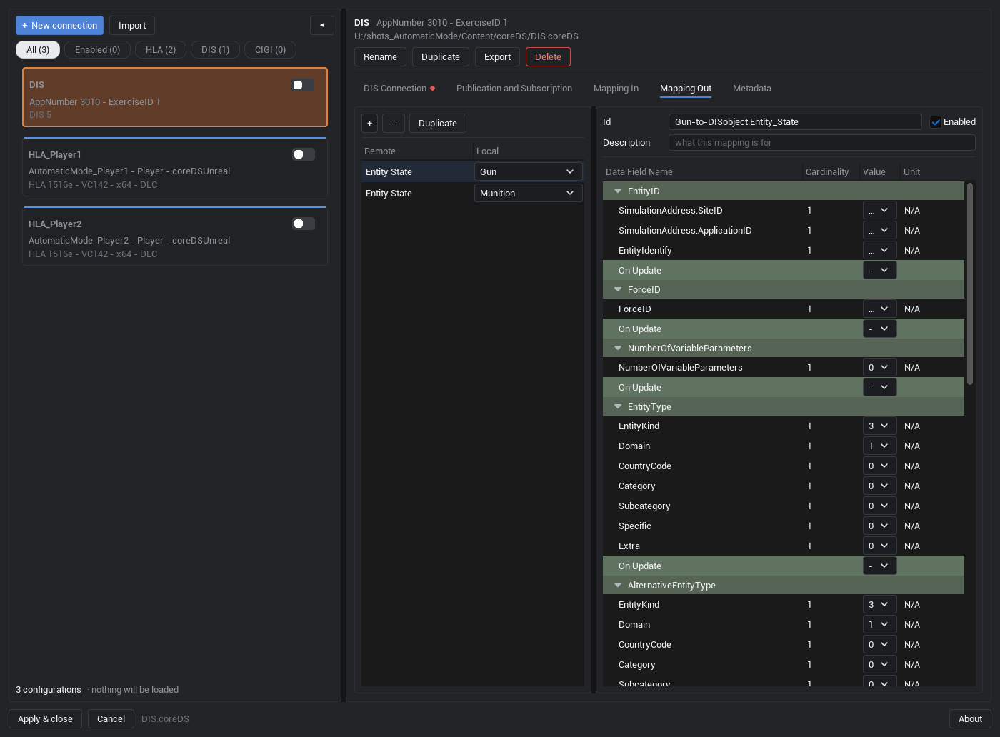

Set ``convertUnrealPositionToDIS.lua`` as the "On Data Updated" script of the Location group and ``convertOrientationFromUnrealToDIS.lua`` as the one of the Orientation group. Scripts are located in ``Content/coreDS/Script``.

High-Level Architecture (HLA)
-----------------------------

For both configurations, configure the connection to the correct RTI.

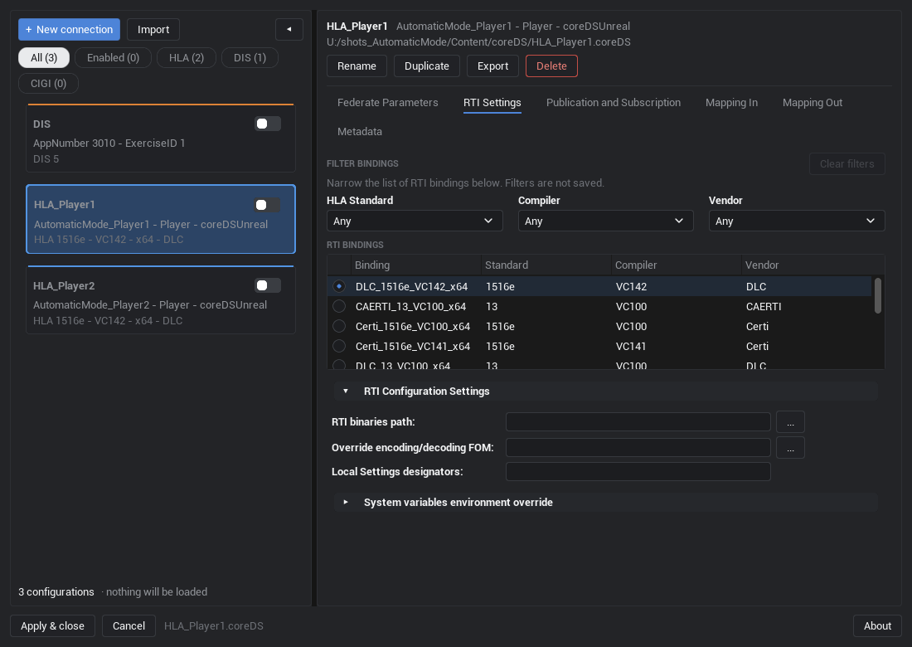

coreDS-based products support a wide variety of RTIs, HLA versions and binding types. It is important to select the correct RTI settings combination. Although coreDS tries to inform you at runtime if the selected combination is invalid, this is not a failsafe process: an incorrect combination can lead to an unexpected crash. Do not hesitate to contact us if you are unsure about your configuration.

Publication and Subscription
~~~~~~~~~~~~~~~~~~~~~~~~~~~~

In this sample, we subscribe to the EntityType and Spatial attributes of HLAobjectRoot.BaseEntity.PhysicalEntity, and publish the same attributes for HLAobjectRoot.BaseEntity.PhysicalEntity.Lifeform.Human and HLAobjectRoot.BaseEntity.PhysicalEntity.Munition.

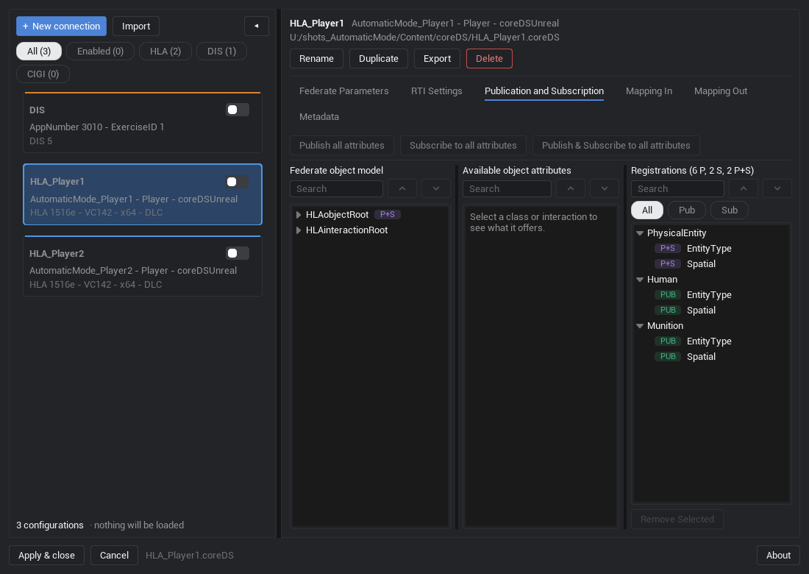

Federate Parameters
~~~~~~~~~~~~~~~~~~~

The Federate Parameters pane contains all the information required to create, join and configure a connection to the RTI, including the FOM file, ``Content/coreDS/RPR_FOM_v2.0_1516-2010.xml``.

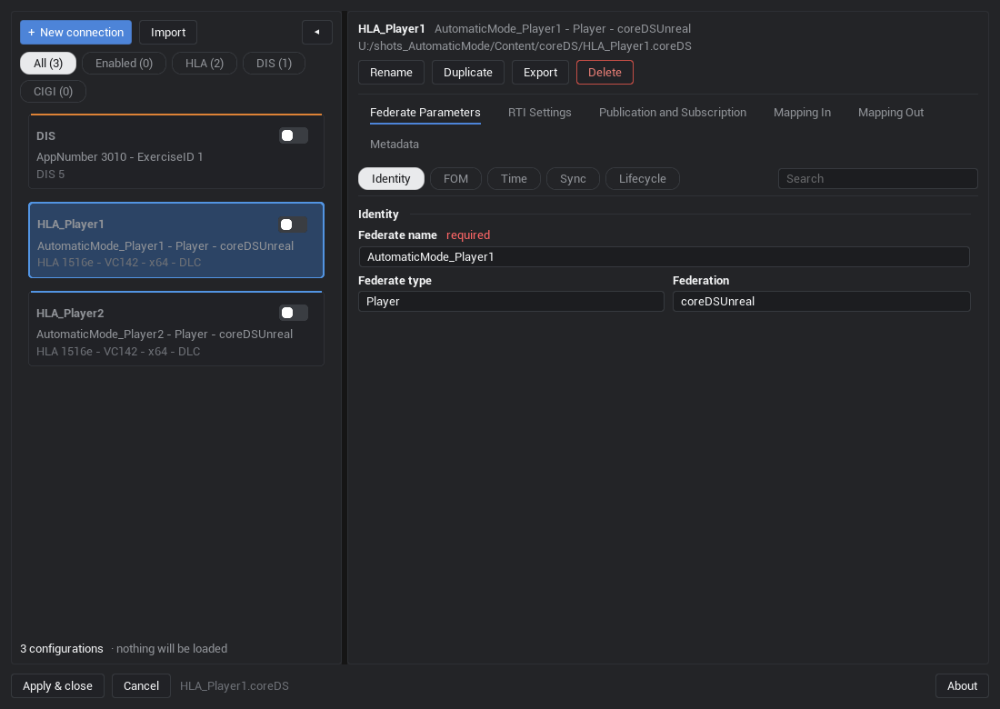

Receiving
^^^^^^^^^

Then comes the mapping configuration. To receive, we care about the "Mapping In".

The first step is to map a local object to a protocol object. "AutomaticMode" is listed in the "+" list. Link the HLA object class to "AutomaticMode": this sample uses "HLAobjectRoot.BaseEntity.PhysicalEntity".

Then you must map the local properties to the protocol properties: here, the location and the orientation of the Spatial attribute. As for DIS, set the "On Data Received" script of the EntityType attribute to ``UseEntityTypeAsUniqueIdentifier.lua`` so the EntityType is used as the ObjectClassSelector.

Dead Reckoning
^^^^^^^^^^^^^^

If dead reckoning is enabled, you must map the DR properties like this:

Coordinates
^^^^^^^^^^^

Finally, we receive coordinates in geocentric format, which Unreal doesn't use. To keep everything configurable at runtime, we use the embedded Lua scripting engine to convert from geocentric coordinates to flat coordinates centred on the reference latitude and longitude.

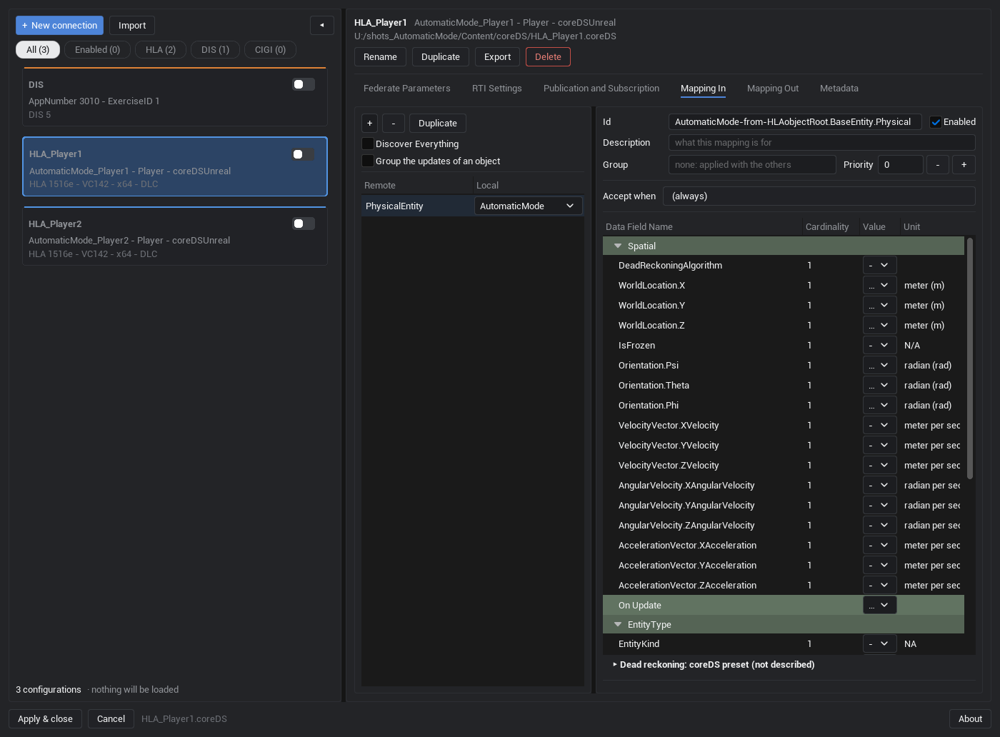

Below is ``convertPositionFromHLAToUnreal.lua``, the "On Data Received" script of the Spatial attribute. It converts the location and the orientation. Scripts are located in ``Content/coreDS/Script``.

.. code-block:: lua

   angleConversions = require("angleConversions")
   require("ecef2lla")
   require("ReferenceLatLongAlt")

   function convertPositionFromHLAToUnreal(value)
      -- Since we are working over a fairly small part of the planet, we can assume a flat surface
      a, b, c = EcefToEnu(value['WorldLocation.X']:toDouble(), value['WorldLocation.Y']:toDouble(), value['WorldLocation.Z']:toDouble(), referenceOffset_Lat , referenceOffset_Long , referenceOffset_Alt )

      --convert geocentric to lat/long
      lat, long, alt = ecef2lla(value['WorldLocation.X']:toDouble(), value['WorldLocation.Y']:toDouble(), value['WorldLocation.Z']:toDouble())

      lat = 0.0174532925 * lat  -- convert to radian
      long = 0.0174532925 * long  -- convert to radian

      yaw = angleConversions.getOrientationFromEuler(lat, long, value['Orientation.Psi']:toDouble(), value['Orientation.Theta']:toDouble())
      pitch = angleConversions.getPitchFromEuler(lat, long, value['Orientation.Psi']:toDouble(), value['Orientation.Theta']:toDouble())
      roll = angleConversions.getRollFromEuler(lat, long, value['Orientation.Psi']:toDouble(), value['Orientation.Theta']:toDouble(), value['Orientation.Phi']:toDouble())

      value['Orientation.Psi']:set(roll)
      value['Orientation.Theta']:set(pitch)
      value['Orientation.Phi']:set(yaw)

      --scale back from meter to cm
      value['WorldLocation.X']:set(b*100)
      value['WorldLocation.Y']:set(a*100)
      value['WorldLocation.Z']:set(c*100)

   end

At this point, you are done. Depending on your Automatic Mode settings, each time a new PhysicalEntity is discovered, a new actor is spawned and coreDS Unreal handles its complete life cycle.

Sending
^^^^^^^

As for DIS, the actors to publish carry a "coreDS sender component" (see the DIS `Sending <automatic-mode-sample-dis-sending_>`_ section). In this sample, "Gun" is mapped to HLAobjectRoot.BaseEntity.PhysicalEntity.Lifeform.Human and "Munition" to HLAobjectRoot.BaseEntity.PhysicalEntity.Munition.

Then you must map the local properties to the protocol properties. When sending, you must fill the complete structure. Static values can be set at this point. Map the location and the orientation of the Spatial attribute to the local properties.

Finally, we send coordinates in local format, which the RPR FOM doesn't use. We use the embedded Lua scripting engine to convert from flat coordinates, centred on the reference latitude and longitude, to geocentric coordinates.

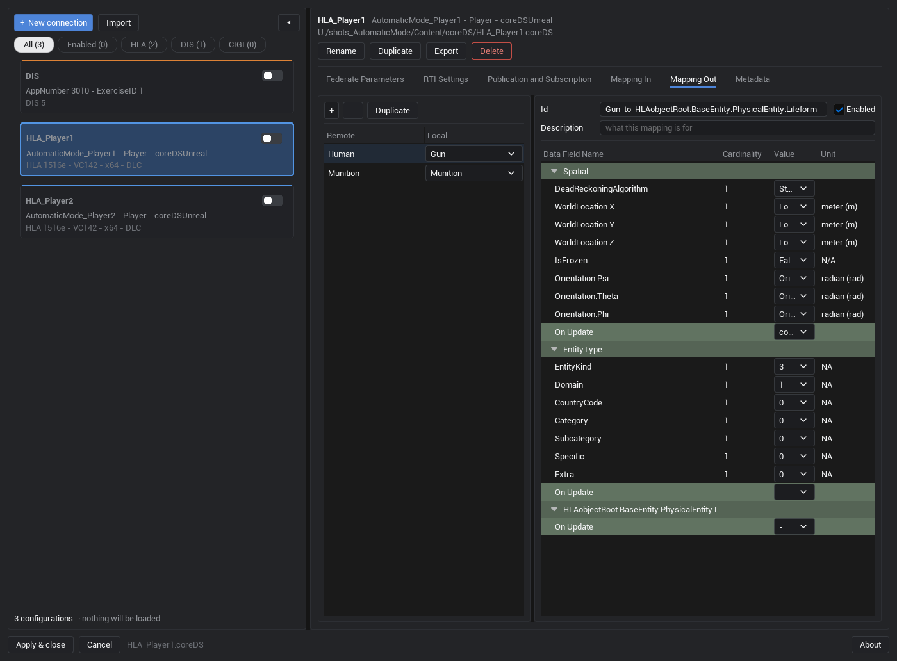

Set ``convertUnrealPositionToHLA.lua`` as the "On Data Updated" script of the Spatial attribute. It converts the location and the orientation. Scripts are located in ``Content/coreDS/Script``.
